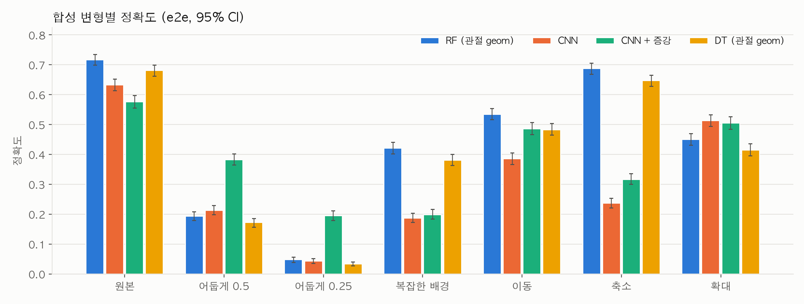
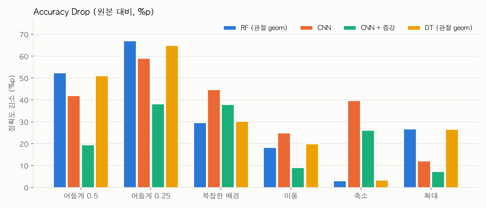
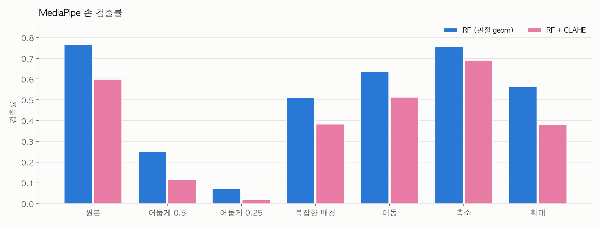
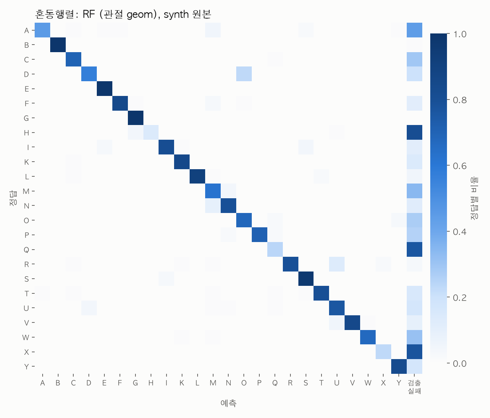
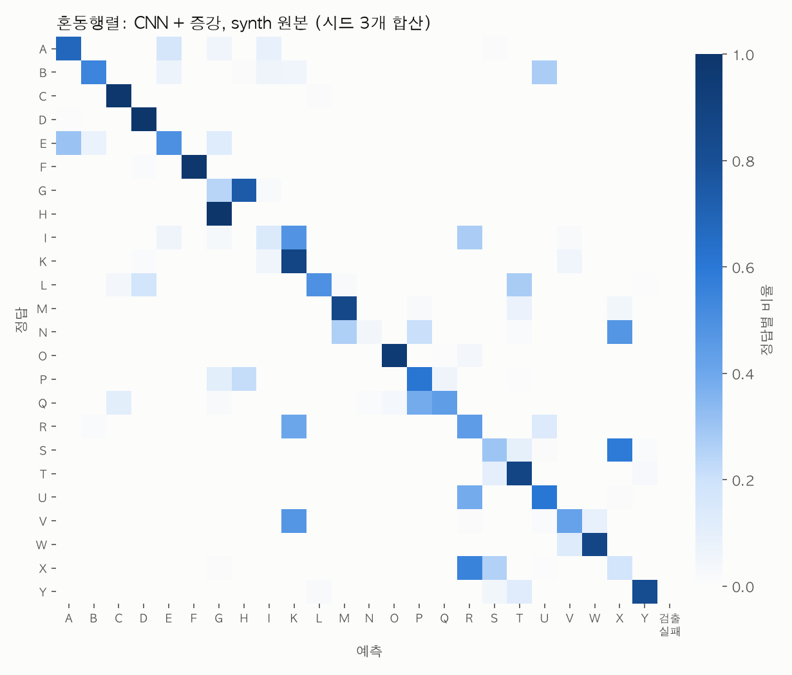
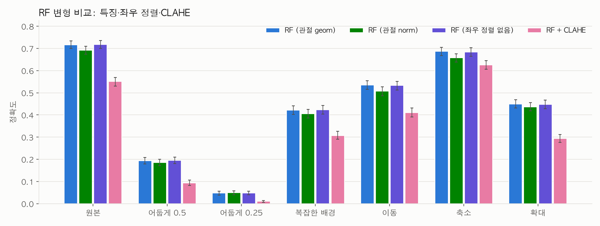

# 최종 보고서: 수어 알파벳 인식에서의 AI 모델 성능 비교

> CNN(이미지 픽셀)과 Random Forest(MediaPipe 손 관절 좌표)를 촬영 환경 변화에 따라 비교했다. 모든 수치는 실제 실행 결과 파일(`results/summary.csv`, `results/summary_seed_mean.csv`, `results/drop.csv`)에서 가져왔다. 실험별 근거는 `docs/experiments/EXP-001…005`에 있다.
>
> **상태 (2026-11-22):** 합성 환경 변형 실험까지 끝났다. **팀원 직접 촬영 테스트셋(실험의 핵심 외적 검증)은 아직 수집 전이다**(`docs/PHOTO_PROTOCOL.md`). 사진이 들어오면 6절의 명령으로 결과를 채운다.

## 1. 한 줄 결론
**어느 한 방식이 모든 환경에서 강하지는 않았다.** 손 관절 + RF는 원본, 손 위치 이동, 손 크기 축소, 복잡한 배경에서 가장 높았다. 증강한 CNN은 **어두운 조명**에서 RF의 약 두 배였다. RF의 약점은 분류가 아니라 **MediaPipe 손 검출 실패**였고, CNN의 약점은 **학습 사진과 다른 위치·크기·배경에 대한 일반화**였다.

## 2. 연구 질문과 설정
- **질문:** 이미지를 직접 학습하는 CNN과 손 관절 좌표를 쓰는 머신러닝 모델 중, 어떤 방식이 촬영 환경 변화에 더 강한가?
- **데이터:** Kaggle ASL Alphabet에서 **정적 알파벳 24개**(J·Z 제외), 클래스당 3,000장, 총 72,000장. 기획안의 6개(A, B, C, L, V, Y)보다 늘렸다.
- **분할(EXP-001):** 이 데이터는 영상 연속 프레임이라 99.5%의 이미지가 거의 같은 이웃을 갖는다. 그래서 dHash로 근접 중복을 군집으로 묶고, **군집 단위로** train 60% / val 20% / test 20%로 나눴다. 무작위로 나누면 같은 장면이 train과 test에 함께 들어가 정확도가 부풀려진다.
- **모델:**

| | 입력 | 구성 |
|---|---|---|
| RF (관절 geom) | MediaPipe 관절 21점 → 손목 기준·손 크기 정규화 좌표 63 + 관절 쌍거리 210 + 손가락 굴곡각 15 = 288차원 | RandomForest 300그루 |
| DT (보조) | 같은 특징 | DecisionTree, max_depth 20 |
| CNN | 128×128 이미지 | 합성곱 4블록, 파라미터 396,024개, Colab T4, 시드 3개 |
| CNN + 증강 | 같은 이미지 | 위와 같음 + 좌우 반전·회전·이동·확대·밝기·대비 증강 |

- **평가:** 두 모델에 **같은 테스트 이미지**를 쓴다. **e2e 정확도**: MediaPipe가 손을 못 찾으면 RF의 오답으로 세고, 분모는 전체 장수다. 지표는 Accuracy, Confusion Matrix, Accuracy Drop(원본 대비 감소 폭, %p)이다.
- **환경 변화(합성):** test split에서 클래스당 100장(2,400장)에 같은 시드로 변형을 적용했다.

| 기획안 실험 | 합성 조건 |
|---|---|
| 1. 일반 조명 | 원본(clean) |
| 2. 어두운 조명 | 어둡게 0.5, 어둡게 0.25(감광 + 센서 노이즈) |
| 3. 복잡한 배경 | 가장자리에 색 도형과 텍스처 잡음(clutter) |
| 4. 손 위치 변화 | 이동 ±20%, 축소 0.6배, 확대 1.35배 |

## 3. 핵심 결과: 합성 환경 변형 (정확도, CNN은 시드 3개 평균)
| 조건 | RF (관절) | DT (관절) | CNN | CNN + 증강 |
|---|---|---|---|---|
| 원본 | **0.717** | 0.680 | 0.632 | 0.576 |
| 어둡게 0.5 | 0.193 | 0.172 | 0.213 | **0.383** |
| 어둡게 0.25 | 0.047 | 0.033 | 0.042 | **0.194** |
| 복잡한 배경 | **0.421** | 0.380 | 0.187 | 0.199 |
| 이동 | **0.534** | 0.482 | 0.385 | 0.486 |
| 축소 | **0.687** | 0.648 | 0.237 | 0.316 |
| 확대 | 0.450 | 0.415 | **0.513** | 0.505 |



### Accuracy Drop (원본 대비 %p, 작을수록 강함)
| 조건 | RF | DT | CNN | CNN + 증강 |
|---|---|---|---|---|
| 어둡게 0.5 | 52.3 | 50.9 | 41.9 | **19.3** |
| 어둡게 0.25 | 67.0 | 64.8 | 59.0 | **38.2** |
| 복잡한 배경 | **29.6** | 30.0 | 44.5 | 37.7 |
| 이동 | 18.2 | 19.8 | 24.8 | **9.0** |
| 축소 | **3.0** | 3.3 | 39.6 | 26.0 |
| 확대 | 26.7 | 26.5 | 11.9 | **7.1** |



Kaggle 내부 셋(변형 없음)의 정확도는 RF test 0.754 / val 0.727, CNN test 0.601 / val 0.669, CNN+증강 test 0.545 / val 0.539다.

## 4. 분석
### 4.1 RF: 손실의 대부분은 "검출 실패"다
- 원본에서 MediaPipe 검출률은 76.7%이고, **검출된 사진만 보면 RF는 93.4%를 맞힌다**(EXP-003). e2e 정확도 71.7%와의 차이는 거의 전부 검출 실패다.
- 어두운 조건에서 검출률은 25%(어둡게 0.5), 7%(어둡게 0.25)까지 떨어진다. 그래서 RF가 무너진다.
- 좌표 정규화 덕분에 **손 크기 축소에는 거의 영향이 없다**(Drop 3.0%p). 이동과 확대는 손이 화면 밖으로 잘리면서 검출이 떨어진다.
- Kaggle 원본 자체에 역광 실루엣과 잘린 손이 많아서 깨끗한 이미지에서도 약 20%가 검출되지 않는다(EXP-002). 특히 test split에는 H·X·Q의 검출이 어려운 촬영 회차가 통째로 들어가 있다. 이 세 클래스의 test 검출률은 16~22%다(EXP-005).



### 4.2 CNN: 학습 사진의 구도 밖에서 약하다
- train 정확도는 99%를 넘지만, 다른 촬영 회차(그룹 분할 val)에서는 54~74%다(EXP-004).
- 증강 없는 CNN은 손 위치 이동에서 24.8%p, 축소에서 39.6%p 떨어진다. Kaggle 사진은 구도가 거의 같아서, 손 모양과 함께 "그 위치의 그 크기"에 기댄 것으로 본다.
- 증강을 넣으면 이동(Drop 24.8→9.0%p)과 어두움(41.9→19.3%p)이 크게 좋아진다. 축소는 26.0%p로 여전히 크다. 대신 원본 정확도가 5.6%p 떨어진다.
- 복잡한 배경은 증강으로도 해결되지 않는다(약 20%). 배경 변화는 증강에 들어 있지 않다.

### 4.3 혼동행렬
- RF는 모양이 비슷한 쌍을 헷갈린다. D→O 23%, R→U 13%, N→M 9%다.
- CNN은 **H↔G**(손가락 1개와 2개로 옆을 가리킴)와 **S↔X**를 거의 구분하지 못한다(H 정확도 0~1%).

| RF (관절) | CNN + 증강 |
|---|---|
|  |  |

### 4.4 보조 비교와 개선 시도
- **RF vs DT:** RF가 모든 조건에서 3~4%p 높다.
- **특징:** 거리·각도를 더한 geom이 정규화 좌표만 쓴 norm보다 원본에서 2.5%p 높다.
- **좌우 정렬:** 정확도 차이가 없다(0.717 vs 0.718). Kaggle이 거의 한 손이기 때문이다. 왼손 사진에 대비해 유지한다.
- **CLAHE 밝기 보정(검출 전):** 모든 조건에서 검출률이 오히려 떨어져 **기각**했다(원본 76.7→59.9%, 어둡게 0.5 25.2→11.6%; EXP-005).



## 5. 한계 (결론이 미치는 범위)
1. **환경 변화가 합성이다.** 실제 조명·배경·촬영 거리가 아니다. 팀원 직접 촬영셋으로 같은 비교를 해야 외적 타당성이 생긴다(6절).
2. **Kaggle 데이터는 촬영자와 장소가 사실상 하나다.** 그룹 분할로 중복 누수는 줄였지만, 사람이나 배경의 다양성은 만들 수 없다.
3. **비교 조건이 같지 않다.** RF는 대량의 손 데이터로 사전학습된 MediaPipe 위에서 동작하고, CNN은 처음부터 학습한 소형 모델이다. 따라서 "머신러닝 vs 딥러닝"보다 "사전학습 손 검출기 + 분류기 vs 처음부터 학습한 이미지 분류기"의 비교로 읽어야 한다.
4. **증강과 평가 변형이 겹친다.** CNN+증강이 어두움·이동에 강한 것은 일부는 학습 때 비슷한 변형을 봤기 때문이다.
5. **통계와 탐색:** CNN 시드 3개, 95% 부트스트랩 CI(시드 분산은 별도 표기), 다중비교 보정 없음. 하이퍼파라미터는 RF·DT만 작은 격자(4개, 3개)에서 골랐고, CNN은 탐색하지 않았다.
6. **수정 기록(2026-11-22):** 처음 계산한 이동·축소 결과는 Kaggle 사진의 파란 테두리(1~2px) 때문에 빈 곳이 진한 파란색으로 채워져 있었다. 테두리를 지우고 다시 평가했다(`perturb.unframe`). 증강 없는 CNN의 이동 정확도는 0.072에서 0.385로 올랐다. 즉 처음 결과의 "CNN이 이동에서 우연 수준"은 상당 부분 이 인공물 때문이었다. 다른 조건의 값은 바뀌지 않았다.

## 6. 직접 촬영 검증 (대기 중)
팀원이 `docs/PHOTO_PROTOCOL.md`대로 찍어 `data/custom_test/`에 넣으면 다음을 실행한다.
```bash
uv run python -m signlight.custom_test check                          # 폴더·장수 확인
uv run python -m signlight.rf --testsets custom                       # RF/DT (로컬)
scripts/colab_cnn.sh --predict-only --testsets custom                 # CNN (Colab)
uv run python -m signlight.report                                     # 표·그림 갱신
```
그 결과로 이 절과 1절의 결론을 갱신한다. 확인할 것은 세 가지다. ① 실제 어두운 조명에서도 RF가 검출 실패로 무너지는가 ② 실제 복잡한 배경에서도 CNN이 약한가 ③ 합성 결과와 같은 방향인가.

## 7. 기대 효과 대비
| 기획안 기대 효과 | 결과 |
|---|---|
| CNN과 관절 기반 ML의 특징·차이 이해 | RF는 검출에 의존하고 위치·크기에 강하다. CNN은 학습 구도 밖에서 약하고, 증강에 크게 반응하며, 어두운 조명에는 RF보다 강하다 |
| 환경 변화에 따른 모델별 성능 분석 | 합성 7개 조건으로 완료. 실제 환경은 직접 촬영 후 갱신 |
| 실생활 적용 가능성과 한계 | 어두운 곳에서는 손 검출 단계가 병목이다. 실서비스라면 검출 실패를 사용자에게 알리고(조명 안내), 다양한 사람·배경 데이터가 필요하다 |

## 8. 재현
```bash
uv sync
./scripts/download_data.sh                 # Kaggle 데이터 (kaggle auth login 필요)
uv run python -m signlight.data            # 인덱스·그룹 분할 (EXP-001)
uv run python -m signlight.landmarks       # 관절 추출 (~10분)
uv run python -m signlight.rf              # RF/DT + 합성 평가 (EXP-003)
uv run python -m signlight.rf --clahe      # CLAHE 실험 (EXP-005)
scripts/colab_cnn.sh                       # CNN 6회 학습·예측 (Colab T4, ~70분)
uv run python -m signlight.report          # 표·그림
uv run pytest -q                           # 테스트
```
